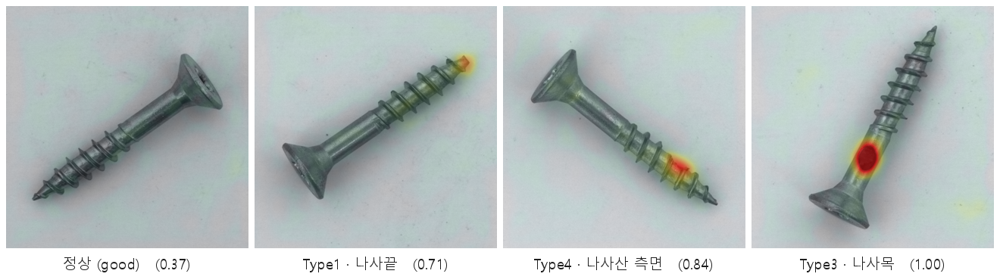
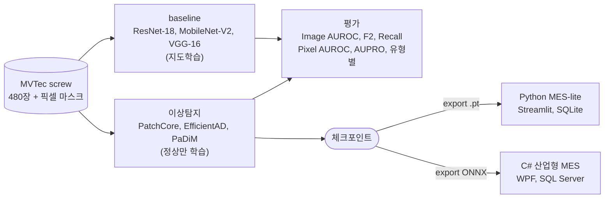

# Screw Defect Detection → MES
### 지도학습 baseline에서 비지도 이상탐지(PatchCore)로, 그리고 MES 운용까지

정상 이미지만 학습해 나사 결함의 유무와 위치를 찾고, 학습한 모델을 생산 현장의 MES로 운용한 프로젝트

개인 프로젝트 · 졸업논문 고도화 (2026.02 ~ 2026.06)

정상은 차분하고 결함은 그 위치만 뜨겁게 반응 (괄호 = 이상 점수, 판정 임계값 0.513)

## 프로젝트 요약

- 졸업논문의 지도학습 분류(ResNet-18)는 결함 유형당 20장으로 학습해야 했고, 분류기라 결함의 위치를 짚지 못함 (Type4 위치 AUPRO 0.45)
- 정상(good) 이미지만 학습하는 비지도 이상탐지(PatchCore)로 전환해 결함 119장 전부를 평가에 쓰고, 픽셀 마스크로 위치를 정량 평가
- 해상도, coreset, 모델 3축으로 비교 실험해 정확도와 속도의 트레이드오프를 정량화
- 학습한 모델을 Python MES와 C# 산업형 MES 두 형태로 운용 (같은 모델을 .pt와 ONNX로 배포)
- 실행 방법: [docs/overview.md](docs/overview.md#6-실행-명령-레포-루트에서)

| 항목 | 결과 |
|---|---|
| 데이터셋 | MVTec AD screw 480장 (정상 361, 결함 119, 5유형, 픽셀 마스크) |
| baseline | ResNet-18 Test F2 0.9896 (논문 보고 값), 위치는 Type4 Pixel AUROC 0.65 |
| 검출 성능 | PatchCore Image AUROC 0.96, 임계값 0.513에서 결함 119장 중 118장 검출 (Recall 0.992) |
| 위치 성능 | AUPRO 0.966, Pixel AUROC 0.993 (coreset 0.1, 해상도 320), Type4 위치 0.971 → 0.984 (256 → 320) |
| 처리 속도 | 28 FPS (p50 35ms, coreset 0.01, 해상도 320, 측정 당시 RTX 2070 SUPER) |
| MES | Python(Streamlit, SQLite) + C#(WPF, ONNX, SQL Server), C#과 Python 점수 일치 36/36 |

## 목차

1. [개발 배경](#1-개발-배경)
2. [프로젝트 구성](#2-프로젝트-구성)
3. [데이터셋](#3-데이터셋)
4. [실험 요약](#4-실험-요약)
5. [기술 스택](#5-기술-스택)
6. [프로젝트 정보](#6-프로젝트-정보)
7. [회고](#7-회고)
8. [관련 문서](#8-관련-문서)

## 1. 개발 배경

- 데이터 부족: 지도학습 baseline은 결함 이미지 100장(유형당 20장)을 학습에 써야 해 분산이 크고, 평가에 남는 결함은 19장뿐
- 위치를 못 짚음: 분류기는 위치를 학습하지 않아 Grad-CAM에 의존, 분류 성능(F2 0.9896)이 높아도 Type4(나사산 측면)는 Pixel AUROC 0.65, AUPRO 0.45
- 데이터 재발견: 논문 데이터 480장이 MVTec AD screw와 바이트 단위로 동일함을 해시로 확인 → 정상만 학습하는 이상탐지로 바꾸면 결함 119장 전부를 평가에 쓰고 위치를 정량 평가 가능

## 2. 프로젝트 구성

| 트랙 | 하는 일 | 핵심 결과 | 상세 |
|---|---|---|---|
| baseline | 지도학습 이진분류 3종 비교, Grad-CAM 위치평가 | ResNet-18 F2 0.9896, Type4 위치 0.65 | [docs/baseline.md](docs/baseline.md) |
| PatchCore | 정상만 학습, 모델·해상도·coreset 비교 | AUPRO 0.966, Type4 위치 0.984 | [docs/patchcore.md](docs/patchcore.md) |
| MES | 모델을 검사 시스템에 연결 (Python, C#) | 28 FPS, 파리티 36/36 | [docs/mes.md](docs/mes.md) |

- 코드: `src/supervised`(baseline), `src/anomaly`(이상탐지), 실행 스크립트는 `experiments/`, 모든 경로는 `src/common/paths.py` 기준
- 전체 구조와 환경, 실행 명령: [docs/overview.md](docs/overview.md)

## 3. 데이터셋

- [MVTec AD](https://www.mvtec.com/company/research/datasets/mvtec-ad) screw 카테고리 (1024×1024, 픽셀 마스크 제공, CC BY-NC-SA 4.0 — 비상업적 연구용, 출처 표기)
- 결함 5유형: 나사끝(Type1), 나사머리(Type2), 나사목(Type3), 나사산 측면(Type4), 나사산 상단(Type5)
- 이상탐지는 MVTec 표준 분할(학습 정상 320, 평가 정상 41 + 결함 119), baseline은 논문 분할(학습 425, 평가 55)을 `splits/baseline_split.csv`로 정의하고 이미지는 `data/screw` 한 벌만 사용

## 4. 실험 요약

### 4-1. baseline: ResNet-18, MobileNet-V2, VGG-16

- 클래스 가중치 Grid Search + Stratified 5-Fold CV로 학습, ResNet-18이 모든 지표에서 최고 (Test F2 0.9896, 논문 보고 값)
- VGG-16은 학습 손실이 거의 줄지 않아 성능이 낮고, MobileNet-V2는 5-seed 반복에서 평균 F2 0.818 ± 0.044
- Grad-CAM 위치평가에서 Type4는 Pixel AUROC 0.65, AUPRO 0.45 — 이상탐지로 전환한 동기
- 상세: [docs/baseline.md](docs/baseline.md)

### 4-2. PatchCore 이상탐지

- 모델: PatchCore가 EfficientAD, PaDiM보다 검출(Image AUROC 0.96)과 위치(AUPRO 0.966) 모두 최고
- 해상도: 256 → 320에서 Type4 위치 0.971 → 0.984로 가장 크게 개선
- coreset: 0.1 → 0.01로 학습 7.8배, 추론 2배 빨라지고 AUPRO 손실은 0.010 (MES에는 0.01 채택)
- 같은 이미지 비교: Type4 test 3장에서 PatchCore는 실제 결함 위치에 반응, baseline은 결함이 아닌 나사머리 쪽을 칠함 (단 PatchCore도 정상 오경보와 배경 오반응이 있음)
- 상세: [docs/patchcore.md](docs/patchcore.md)

### 4-3. MES 운용

- Python MES-lite: 라인 시뮬레이터 → 추론 → SQLite → Streamlit 관제 (불량률·이상점수 추이, 결함 위치 히트맵)
- C# 산업형 MES: WPF(MVVM) + EF Core + SQL Server, ONNX Runtime으로 .NET에서 직접 추론, 작업지시 → Lot → 검사 추적성
- 같은 체크포인트를 .pt와 ONNX로 export, C#과 Python 점수 일치(36/36)
- 상세: [docs/mes.md](docs/mes.md)

## 5. 기술 스택

| 구분 | 기술 |
|---|---|
| 이상탐지 | anomalib 2.5, PyTorch (PatchCore, EfficientAD, PaDiM) |
| baseline | PyTorch, torchvision (ResNet-18, MobileNet-V2, VGG-16), pytorch-grad-cam |
| 평가 | scikit-learn, Pixel AUROC, AUPRO (`anomalib.metrics.aupro`) |
| 모델 배포 | TorchInferencer(.pt), ONNX, ONNX Runtime |
| Python MES | Streamlit, SQLite, pandas |
| C# MES | .NET 8, WPF(MVVM, CommunityToolkit.Mvvm), EF Core 8, SQL Server LocalDB, LiveCharts2, ImageSharp |
| 환경 | Windows 11, conda, CUDA |

## 6. 프로젝트 정보

| 항목 | 내용 |
|---|---|
| 기간 | 2026.02 ~ 2026.06 |
| 형태 | 개인 프로젝트 (졸업논문 baseline 고도화) |
| 역할 | 데이터 분석, 모델링, 평가 설계, 비교 실험, Python/C# MES 구현 전 과정 |
| 졸업논문 | [딥러닝 기반 나사 결함 탐지 모델 성능 비교에 관한 연구](docs/thesis/딥러닝%20기반의%20나사%20결함%20탐지%20모델%20성능%20비교에%20관한%20연구.pdf) |

## 7. 회고

- 잘한 점
  - baseline의 한계를 수치(Type4 위치 0.65/0.45)로 확인한 뒤 이상탐지로 전환하고, 해상도, coreset, 모델 3축으로 비교해 선택 근거를 정량화
  - 결함 유형 자동분류를 시도하고, 무작위 수준(20%)임을 데이터로 확인한 뒤 제외
  - 같은 모델을 .pt와 ONNX 두 경로로 배포하고 C#과 Python 점수 일치(36/36)를 검증
  - 논문 데이터가 MVTec 원본과 동일함을 해시로 확인해 중복 데이터 377MB를 제거하고, 리팩터링 전후 분할과 지표가 동일함을 검증
- 아쉬운 점
  - 임계값 0.513은 test셋에서 F2를 최대화해 골랐기 때문에, 같은 데이터로 튜닝하고 평가한 Recall 0.992는 낙관적일 수 있음 (val 홀드아웃이 필요)
  - 정상 오경보가 큼: 재학습 모델은 정상 41장 중 15장을 불량으로 판정, 학습마다 편차(9~15장)가 있고 대시보드 불량률이 40%대로 보임
  - baseline과 PatchCore 비교는 split이 달라 엄밀하지 않음, baseline test는 결함이 19장뿐이라 같은 설정으로 재학습해도 F2가 0.885~0.990으로 흔들림 (논문 0.9896, 저장 모델 0.885, 재학습 0.904)
  - 속도는 측정 당시 환경(RTX 2070 SUPER) 수치이고 이 PC에서 재측정하지 않음, 시연은 MVTec test 이미지 시뮬레이션이며 실제 카메라 입력은 미검증
- 향후 계획
  - val 홀드아웃으로 임계값 선정, 시드 고정과 반복 평가로 신뢰구간 제시
  - 정상 오경보 감소: 앙상블, 후처리, 입력 정렬(회전) 검토
  - 실제 카메라 연동, FastAPI 추론 서비스 분리, 결함 유형은 별도 지도학습 보조 모델로 분류

## 8. 관련 문서

| 문서 | 내용 |
|---|---|
| [docs/baseline.md](docs/baseline.md) | 지도학습 baseline 3종, 학습 방법, Grad-CAM 위치평가 |
| [docs/patchcore.md](docs/patchcore.md) | PatchCore 이상탐지 실험 (모델 비교, 해상도, coreset, 속도, baseline 비교) |
| [docs/mes.md](docs/mes.md) | 학습한 모델을 운용하는 MES (Python, C#, ONNX 파리티) |
| [docs/overview.md](docs/overview.md) | 레포 구조, 데이터, 환경, 실행 명령, 진행 현황 |
| [docs/decisions.md](docs/decisions.md) | 결정과 문제 해결 기록 |
| [mes/README.md](mes/README.md), [csharp/README.md](csharp/README.md) | MES 코드 상세 |

## 참고

- MVTec AD: Bergmann et al., "MVTec AD — A Comprehensive Real-World Dataset for Unsupervised Anomaly Detection", CVPR 2019
- PatchCore: Roth et al., "Towards Total Recall in Industrial Anomaly Detection", CVPR 2022
- anomalib: https://github.com/open-edge-platform/anomalib
