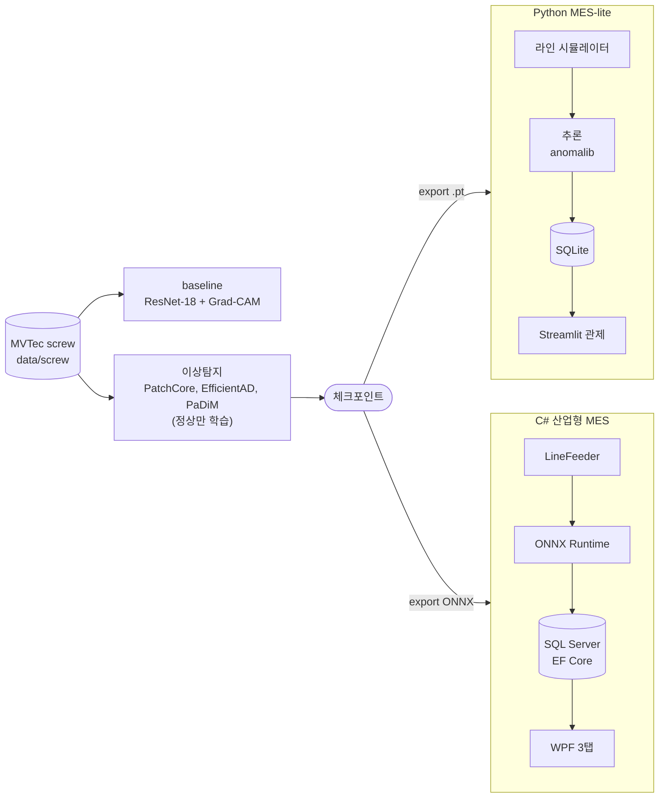

# Screw Defect Detection → MES
### 비지도 이상탐지 기반 나사 결함 검출 · 위치 정량평가 · MES 운용

정상 이미지만 학습해 나사 결함의 유무와 위치를 찾고, 검사 결과를 생산 현장의 MES로 운용하는 품질검사 시스템

개인 프로젝트 · 졸업논문 고도화 (2026.02 ~ 2026.06)

라인 시뮬레이터가 흘려보낸 나사를 실시간 판정 — 불량률·이상점수 추이와 결함 위치 히트맵 (Python MES 대시보드)

## 프로젝트 요약

- 졸업논문의 지도학습 분류(ResNet-18)는 결함 유형당 20장으로 학습해야 했고, 분류기라 결함의 위치를 짚지 못함 (Type4 위치 AUPRO 0.45)
- 정상(good) 이미지만 학습하는 비지도 이상탐지(PatchCore)로 전환해 결함 119장 전부를 평가에 쓰고, 픽셀 마스크로 위치를 정량 평가
- 해상도, coreset, 모델 3축으로 비교 실험해 정확도와 속도의 트레이드오프를 정량화
- 학습한 모델을 Python MES와 C# 산업형 MES 두 형태로 운용 (같은 모델을 .pt와 ONNX로 배포)
- 실행 방법: [docs/overview.md](docs/overview.md#6-실행-명령-레포-루트에서)

| 항목 | 결과 |
|---|---|
| 데이터셋 | MVTec AD screw 480장 (정상 361, 결함 119, 5유형, 픽셀 마스크) |
| 검출 성능 | Image AUROC 0.96, 임계값 0.513에서 결함 119장 중 118장 검출 (Recall 0.992) |
| 위치 성능 | AUPRO 0.966, Pixel AUROC 0.993 (coreset 0.1, 해상도 320) |
| 해상도 효과 | Type4(나사산 측면) 위치 0.971 → 0.984 (256 → 320) |
| baseline 대비 | Type4 위치 Pixel AUROC 0.65 (Grad-CAM) → 0.97~0.98 (PatchCore), 두 실험의 split이 달라 참고용 |
| 처리 속도 | 28 FPS (p50 35ms, coreset 0.01, 해상도 320, 측정 당시 RTX 2070 SUPER) |
| MES | Python(Streamlit, SQLite) + C#(WPF, ONNX, SQL Server), C#과 Python 점수 일치 36/36 |

## 목차

1. [개발 배경](#1-개발-배경)
2. [개발 목표](#2-개발-목표)
3. [시스템 아키텍처](#3-시스템-아키텍처)
4. [데이터셋](#4-데이터셋)
5. [모델 비교](#5-모델-비교)
6. [성능 향상 실험](#6-성능-향상-실험)
7. [결과](#7-결과)
8. [MES 운용](#8-mes-운용)
9. [기술 스택](#9-기술-스택)
10. [프로젝트 정보](#10-프로젝트-정보)
11. [회고](#11-회고)
12. [관련 문서](#12-관련-문서)

## 1. 개발 배경

- 데이터 부족
  - 지도학습 baseline은 결함 이미지 100장(유형당 20장)을 학습에 써야 해 분산이 크고 Val-Test 성능이 뒤바뀌는 현상이 있었음
  - 결함이 학습에 묶여 평가에 쓸 수 있는 결함도 19장뿐
- 위치를 못 짚음
  - 분류기는 위치를 학습하지 않아 Grad-CAM에 의존, Type4(나사산 측면)는 Pixel AUROC 0.65, AUPRO 0.45
  - 분류 성능(Test F2 0.9896)이 높아도 "어디가 결함인가"는 답하지 못함
- 데이터 재발견
  - 논문 데이터 480장이 MVTec AD screw와 바이트 단위로 동일함을 해시로 확인 (정상 361, 결함 119, 픽셀 마스크 제공)
  - 정상만 학습하는 이상탐지로 바꾸면 결함 119장 전부를 평가에 쓰고 위치를 정량 평가 가능
- baseline은 [docs/baseline.md](docs/baseline.md), 선택 근거는 [docs/decisions.md](docs/decisions.md)

## 2. 개발 목표

- 결함 데이터 없이 정상만으로 결함을 검출하고 위치까지 표시
- 검출뿐 아니라 위치를 Pixel AUROC, AUPRO로 정량 평가하고 유형별로 분석
- 해상도, coreset, 모델 선택을 실험으로 근거화
- 학습한 모델을 단일 이미지 추론 서비스로 만들어 MES(작업지시, Lot 추적성, 불량 분석)에 연동

## 3. 시스템 아키텍처

- 연구 레이어
  - `src/supervised`(baseline), `src/anomaly`(이상탐지), 실행 스크립트는 `experiments/`
  - 모든 경로는 `src/common/paths.py`를 기준으로 해 실행 위치와 무관하게 동작
- 모델 배포
  - 같은 체크포인트를 Torch(.pt)와 ONNX로 export, 둘 다 전처리와 점수 정규화가 그래프에 내장되어 입력은 원본 RGB를 255로 나눈 값
  - 판정은 모델 내장 라벨이 아니라 임계값 0.513을 직접 적용 (C#도 같은 값)
- C# MES
  - Core(도메인, 인터페이스) → Inference(ONNX) → Data(EF Core) → Simulator → App(WPF MVVM)
  - 작업지시(WO) 1:N Lot 1:N 검사 구조로 추적성 확보
  - 추론 구현을 인터페이스로 분리해 ONNX를 REST 등으로 바꿔도 상위 레이어는 그대로
- 상세 구조: [docs/overview.md](docs/overview.md)

## 4. 데이터셋

- 출처: [MVTec AD](https://www.mvtec.com/company/research/datasets/mvtec-ad) screw 카테고리 (이미지 1024×1024, 픽셀 마스크 제공)
- 라이선스: CC BY-NC-SA 4.0 (비상업적 연구용, 이미지는 출처 표기하여 사용)
- 결함 5유형

| 유형 | MVTec 명칭 | 설명 | 결함 이미지 |
|---|---|---|---:|
| Type1 | manipulated_front | 나사끝 휘어짐, 끊어짐 | 24 |
| Type2 | scratch_head | 나사머리 깨짐 | 24 |
| Type3 | scratch_neck | 나사목 깨짐 | 25 |
| Type4 | thread_side | 나사산 측면 | 23 |
| Type5 | thread_top | 나사산 상단 | 23 |

| 구분 | 이상탐지 (MVTec 표준) | baseline (논문 분할) |
|---|---|---|
| 학습 | 정상 320장 | 정상 325 + 결함 100 = 425장 |
| 평가 | 정상 41 + 결함 119 = 160장 | 정상 36 + 결함 19 = 55장 |

- baseline 분할은 `splits/baseline_split.csv` 매니페스트로 정의하고 이미지는 `data/screw` 한 벌만 사용 (폴더 복사본 377MB 제거)

## 5. 모델 비교

| 모델 | 방식 | 선정 이유 |
|---|---|---|
| PatchCore | 정상 패치 특징의 메모리뱅크 + 최근접 거리 (WideResNet-50, layer2+3, coreset) | 학습 epoch 없이 미세 결함 위치에 강함, 주력 |
| EfficientAD | student-teacher + autoencoder (small, 20 epoch 간이 학습) | 학습형 모델과 비교 |
| PaDiM | 패치별 가우시안 분포 (resnet18) | 가벼운 통계 기반 기준선 |

- 동일 데이터, 동일 지표로 평가 (해상도 320 기준)
- PatchCore가 검출(Image AUROC 0.961), 위치(AUPRO 0.966) 모두 최고
- PaDiM은 불량을 전부 잡지만(Recall 1.0) 정상 오경보가 많아 AUROC 0.764
- EfficientAD는 20 epoch 간이 학습이라 "동일 간이 조건 비교"로 해석해야 함
- 상세: [results/anomaly/model_compare](results/anomaly/model_compare/RESULTS.md)

## 6. 성능 향상 실험

### 6-1. 해상도

- 가설: Type1, Type4 같은 미세 결함은 고해상도에서 위치가 더 정확해짐
- 해상도 256 → 320에서 Type4 위치가 0.971 → 0.984로 가장 크게 개선, AUPRO도 0.941 → 0.966
- 단, 320에서 이미지 단위 놓침이 0 → 2장으로 늘어 위치(어디)는 좋아졌지만 판정(유무)은 임계값 영향을 받음
- 512는 추론 시 거리 계산 텐서가 약 7.5GB를 한 번에 요구해 8GB GPU에서 OOM, coreset과 무관한 한계라 진행하지 않음

### 6-2. coreset 비율

| 지표 (해상도 320) | coreset 0.1 | coreset 0.01 |
|---|---:|---:|
| 학습 시간 | 4212초 (70분) | 538초 (9분) |
| 추론 지연 p50 | 76ms (13 FPS) | 35ms (28 FPS) |
| AUPRO | 0.966 | 0.956 |
| Type4 위치 | 0.984 | 0.978 |

- 메모리뱅크를 10분의 1로 줄이면 학습 7.8배, 추론 2배 빨라지고 위치 정확도 손실은 AUPRO 0.010
- 정밀 우선이면 0.1, 처리량 우선이면 0.01 — MES에는 0.01을 채택
- 지연은 측정 당시 환경(RTX 2070 SUPER) 기준이며 warm-up 제외, `cuda.synchronize()` 후 전처리부터 후처리까지 end-to-end 측정

## 7. 결과

- 표본은 baseline test의 유형별 첫 장 (선별하지 않음), 같은 이미지에 두 모델의 근거를 같은 방식으로 칠함
  - baseline은 Type1에서 결함이 없는 곳을 칠하고, Type3, Type4에서는 결함 주변의 넓은 영역만 가리킴
  - PatchCore는 Type1 나사끝을 정확히 짚고, Type2, Type5는 두 모델 모두 결함을 찾음
  - 정상 샘플(325번)은 이상 점수 0.58로 PatchCore가 불량으로 오판 (오경보)

- 가장 어려운 Type4 test 3장 전부
  - PatchCore는 3장 모두 실제 결함 위치에 반응하지만 022번은 배경에도 반응하고, 020번은 여러 곳으로 분산
  - baseline은 021, 022번에서 결함이 아닌 나사머리 쪽을 칠하고, 021번은 정상(bad 확률 0.28)으로 놓침

| 항목 | 결과 |
|---|---|
| 판정 임계값 | 0.513 (test에서 F2 최대화, 불량을 놓치는 것을 정상 재검사보다 중시) |
| 재학습 모델 (coreset 0.01, 320) | 결함 119장 중 118장 검출 (Recall 0.992), 정상 41장 중 15장 오경보 (Precision 0.887) |
| 최초 학습 모델 | Recall 0.992, 정상 오경보 9장 (Precision 0.929) |
| Pixel AUROC, AUPRO | 재학습 0.990, 0.954 / 최초 0.990, 0.956 |

- 정상 오경보 수는 학습할 때마다 달라짐 (9~15장), 놓침은 1장으로 같음 — coreset 무작위 샘플링과 학습 환경(GPU, 라이브러리 버전) 차이가 섞여 있어 원인을 하나로 특정하지는 못함

## 8. MES 운용

### 8-1. Python MES-lite

- 라인 시뮬레이터가 test 이미지를 1장씩 흘려보내 추론, SQLite에 기록, Streamlit이 실시간 표시
- 구성: 누적 생산, 양품, 불량, 불량률 KPI / 불량률, 이상점수 추이 / 불량 판정 히트맵 갤러리 / 실시간 알람
- 갤러리의 `good_*` 항목은 정상을 불량으로 판정한 오경보 (불량률 40%대는 임계값 0.513과 오경보의 결과이며, 화면에 안내 문구를 표시)
- 결함 유형(Type1~5) 자동분류는 제외 — 히트맵 최고점이 유형과 무관하게 중앙으로 쏠려 위치 기반 분류가 무작위 수준(20%)이었음

### 8-2. C# 산업형 MES

<table>
<tr>
<td width="50%"> 생산현황: 실시간 KPI, 이상점수·불량률 추세, 불량 히트맵</td>
<td width="50%"> 작업지시 · 추적성: WO → Lot → 검사 이력, 선택 검사의 결함 위치 히트맵</td>
</tr>
<tr>
<td> 품질분석: 불량 유형 Pareto (정상 오탐이 가장 큼)</td>
<td>

- WPF(MVVM) + EF Core 코드퍼스트 + SQL Server(LocalDB)
- 작업지시(WO) 생성, 가동 시 Lot 자동 시작, 검사마다 판정 기록
- 외부 Python 없이 ONNX Runtime으로 .NET에서 직접 추론
- 결함 유형(Pareto)은 모델 산출이 아니라 시뮬레이터가 소스 폴더명(정답)으로 주입한 값, 정상을 불량으로 판정하면 "정상(오탐)"으로 집계

</td>
</tr>
</table>

### 8-3. ONNX 파리티 검증

- C#과 Python이 같은 점수를 내는지 test 36장으로 검증 (`ScrewMes.ParityCheck`)
- 재학습 모델 기준 최대 |Δ| 0.0016, 판정 일치 36/36 (최초 학습 모델 0.0001)
- 상세: [csharp/README.md](csharp/README.md), [mes/README.md](mes/README.md)

## 9. 기술 스택

| 구분 | 기술 |
|---|---|
| 이상탐지 | anomalib 2.5, PyTorch (PatchCore, EfficientAD, PaDiM) |
| baseline | PyTorch, torchvision (ResNet-18, MobileNet-V2, VGG-16), pytorch-grad-cam |
| 평가 | scikit-learn, Pixel AUROC, AUPRO (`anomalib.metrics.aupro`) |
| 모델 배포 | TorchInferencer(.pt), ONNX, ONNX Runtime |
| Python MES | Streamlit, SQLite, pandas |
| C# MES | .NET 8, WPF(MVVM, CommunityToolkit.Mvvm), EF Core 8, SQL Server LocalDB, LiveCharts2, ImageSharp |
| 환경 | Windows 11, conda, CUDA |

## 10. 프로젝트 정보

| 항목 | 내용 |
|---|---|
| 기간 | 2026.02 ~ 2026.06 |
| 형태 | 개인 프로젝트 (졸업논문 baseline 고도화) |
| 역할 | 데이터 분석, 모델링, 평가 설계, Python/C# MES 구현 전 과정 |
| 졸업논문 | [딥러닝 기반 나사 결함 탐지 모델 성능 비교에 관한 연구](docs/thesis/딥러닝%20기반의%20나사%20결함%20탐지%20모델%20성능%20비교에%20관한%20연구.pdf) |

## 11. 회고

- 잘한 점
  - baseline의 한계를 수치(Type4 위치 0.65/0.45)로 확인한 뒤 이상탐지로 전환하고, 해상도, coreset, 모델 3축으로 비교해 선택 근거를 정량화
  - 결함 유형 자동분류를 시도하고, 무작위 수준(20%)임을 데이터로 확인한 뒤 제외
  - 같은 모델을 .pt와 ONNX 두 경로로 배포하고 C#과 Python 점수 일치(36/36)를 검증
  - 논문 데이터가 MVTec 원본과 동일함을 해시로 확인해 중복 데이터 377MB를 제거하고, 리팩터링 전후 분할과 지표가 동일함을 검증
- 아쉬운 점
  - 임계값 0.513은 test셋에서 F2를 최대화해 골랐기 때문에, 같은 데이터로 튜닝하고 평가한 Recall 0.992는 낙관적일 수 있음 (val 홀드아웃이 필요)
  - 정상 오경보가 큼: 재학습 모델은 정상 41장 중 15장을 불량으로 판정, 학습마다 편차(9~15장)가 있고 대시보드 불량률이 40%대로 보임
  - baseline과 PatchCore 비교는 split이 달라 엄밀하지 않음, baseline test는 결함이 19장뿐이라 같은 설정으로 재학습해도 F2가 0.885~0.990으로 흔들림 (논문 0.9896, 저장 모델 0.885, 재학습 0.904)
  - 속도는 측정 당시 환경(RTX 2070 SUPER) 수치이고 이 PC에서 재측정하지 않음, 시연은 MVTec test 이미지 시뮬레이션이며 실제 카메라 입력은 미검증
- 향후 계획
  - val 홀드아웃으로 임계값 선정, 시드 고정과 반복 평가로 신뢰구간 제시
  - 정상 오경보 감소: 앙상블, 후처리, 입력 정렬(회전) 검토
  - 실제 카메라 연동, FastAPI 추론 서비스 분리, 결함 유형은 별도 지도학습 보조 모델로 분류

## 12. 관련 문서

| 문서 | 내용 |
|---|---|
| [docs/overview.md](docs/overview.md) | 프로젝트 개요, 레포 구조, 데이터, 환경, 실행 명령 |
| [docs/baseline.md](docs/baseline.md) | 지도학습 baseline, Grad-CAM 위치평가 |
| [docs/anomaly.md](docs/anomaly.md) | 이상탐지 실험 (해상도, coreset, 모델 비교, 속도) |
| [docs/decisions.md](docs/decisions.md) | 결정과 문제 해결 기록 |
| [mes/README.md](mes/README.md), [csharp/README.md](csharp/README.md) | Python MES, C# MES 상세 |
| [results/](results/anomaly/) | 커밋된 실험 결과 (CSV, 요약) |

## 참고

- MVTec AD: Bergmann et al., "MVTec AD — A Comprehensive Real-World Dataset for Unsupervised Anomaly Detection", CVPR 2019
- PatchCore: Roth et al., "Towards Total Recall in Industrial Anomaly Detection", CVPR 2022
- anomalib: https://github.com/open-edge-platform/anomalib
