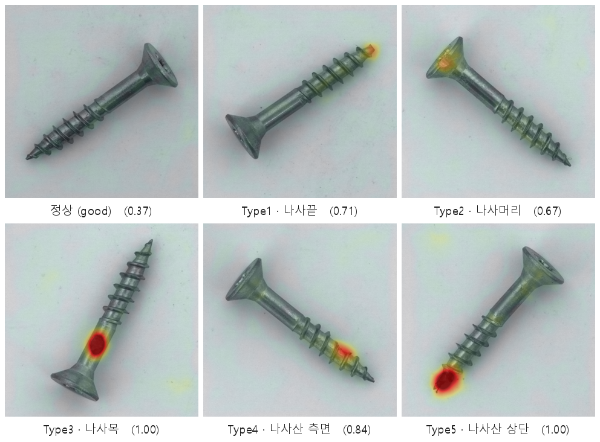

# 이상탐지 트랙 (PatchCore · EfficientAD · PaDiM)

정상(good) 이미지만 학습하는 비지도 이상탐지로 나사 결함을 검출·국소화한다. 코드는 `src/anomaly/`(+ anomalib 2.5), 실행은 `experiments/anomaly/`,
커밋하는 결과는 `results/anomaly/`.

> 정상(good)은 차분하고 결함은 그 위치만 뜨겁게 반응한다(괄호=이상점수, 임계값 0.513). good/결함을 공통 색 스케일로 칠하고 배경을 억제했으며,
> 각 유형의 표본은 GT 마스크와의 농도비로 자동 선별했다. 생성: `python experiments/anomaly/build_heatmap_grid.py`.

## 설계 요약

- **분할**: anomalib 표준 MVTec 프로토콜 — train = good 320, test = good 41 + 결함 119(GT 마스크 포함). 결함 119장 **전부가 평가 데이터**.
- **모델**: 주력 PatchCore(WideResNet-50, layer2+3, coreset 메모리뱅크, k=9) / 비교 EfficientAD(small, 학습형) · PaDiM(resnet18).
- **성능 향상 축**: 입력 해상도(256/320 — Type1·Type4 같은 미세 결함 가설), PatchCore coreset 비율(0.1 / 0.01).
- **임계값**: test 에서 F2 최대화 → **0.513**. FN 최소화 기조(F2 = Recall 4배 가중) — [decisions.md §7](decisions.md).
- **지표**: 이미지(AUROC·F2·Recall·Precision) / 픽셀(Pixel AUROC·AUPRO) / 유형별. `src/anomaly/ad_eval.py`.

## 결과 1 — 해상도 스윕 (PatchCore, coreset 0.1) · [results/anomaly/sweep_cs01](../results/anomaly/sweep_cs01/RESULTS.md)

| 설정 | Image AUROC | F2 | Recall | AUPRO | Type4 위치(pixel AUROC) | 시간 |
|------|-------------|-----|--------|-------|------------------------|------|
| 256 | 0.9627 | 0.9738 | 1.000 (FN 0) | 0.9409 | 0.9706 | 146 s |
| **320** | 0.9611 | 0.9701 | 0.9832 (FN 2) | **0.9663** | **0.9843** | 4212 s (70분) |

→ **해상도↑ 로 Type4(나사산 측면) 위치가 가장 크게 개선**(0.971 → 0.984): 미세·국소 결함에는 고해상도가 유효함을 정량 입증.
단 320 에서 이미지 단위는 FN 2(Type3·Type4 각 1)로 흔들렸다 — 위치(where)는 개선됐으나 판정(whether)은 임계값 영향을 받는다.
512 는 추론 거리계산 텐서가 ~7.5GB 를 한 번에 요구해 8GB GPU 에서 coreset 과 무관하게 OOM → 미진행.

## 결과 2 — coreset 0.1 vs 0.01 (320) · [results/anomaly/sweep_cs001](../results/anomaly/sweep_cs001/RESULTS.md)

| 지표 (320) | coreset 0.1 | coreset 0.01 | 변화 |
|-----------|------------|-------------|------|
| 학습 시간 | 4212 s (70분) | **538 s (9분)** | 7.8배↓ |
| Image AUROC | 0.9611 | 0.9639 | 소폭↑ |
| Recall / FN | 0.9832 / 2 | 0.9916 / 1 | 동급+ |
| AUPRO | **0.9663** | 0.9560 | −0.010 |
| Pixel AUROC | 0.9929 | 0.9904 | −0.0025 |
| Type4 위치 | **0.984** | 0.978 | −0.007 |

→ 0.01 은 고해상도를 실용화(70분→9분)하고 손실이 미미하다. 단 **최고 AUPRO 는 여전히 0.1**. 운용 가이드: 정밀 우선 0.1@320 / 처리량 우선 0.01@320.

## 결과 3 — 모델 비교 · [results/anomaly/model_compare](../results/anomaly/model_compare/RESULTS.md)

| 모델 | Image AUROC | AUPRO(320) | Type4 위치(320) | 비고 |
|------|-------------|-----------|----------------|------|
| **PatchCore** | **0.96** | **0.966** | **0.984** | 주력 |
| EfficientAD | 0.85~0.93 | 0.935 | 0.955 | 학습형(20 epoch 간이), 해상도↑에 민감 |
| PaDiM | 0.76 | 0.908 | 0.945 | Recall 1.0 이나 정상 오경보 ~40/41 |

→ **PatchCore 가 검출·위치 양면 최선**(주력 모델의 정량 근거). EfficientAD 는 20 epoch 간이 학습이라 "동일·간이 조건 비교"로 해석할 것.
EfficientAD 함정: 전처리에 Normalize 를 넣으면 에러 → `make_pp(res, normalize=False)`, batch=1 강제, imagenette 1.5GB 자동 다운로드.

## 결과 4 — 추론 속도 (RTX, PatchCore 4변형) · `results/anomaly/patchcore_all.csv`

| 변형 | coreset | res | 메모리뱅크 | p50 (ms) | p95 (ms) | FPS | AUPRO |
|------|---------|-----|-----------|---------|---------|-----|-------|
| cs01_256 | 0.1 | 256 | 32,768 | 47.8 | 51.6 | 20.4 | 0.9409 |
| cs01_320 | 0.1 | 320 | 51,200 | 75.6 | 79.0 | 13.1 | 0.9663 |
| cs001_256 | 0.01 | 256 | 3,276 | 32.5 | 34.6 | 30.4 | 0.9036 |
| **cs001_320** | 0.01 | 320 | 5,120 | **35.0** | 40.4 | **28.0** | 0.9560 |

PatchCore 추론은 메모리뱅크 k-NN 거리계산이라 메모리뱅크 크기(coreset)가 곧 지연이다. 측정 원칙: warm-up 10장 폐기, `cuda.synchronize()`,
전처리~후처리 end-to-end, p50/p95 보고. → **MES 에는 cs001_320**(AUPRO 0.956 유지하면서 28 FPS)을 채택했다.

## MES 에서의 모델 사용

- 모델 = coreset 0.01 / 320 ckpt. 임계값 0.513 → **Recall 0.992** (TP 118 / FN 1). 정상 오경보는 학습마다 달라 최초 학습본 FP 9(Precision 0.929), 재학습본 FP 15(Precision 0.887) — coreset 무작위 샘플링과 학습 환경(GPU·라이브러리 버전)이 섞여 원인을 특정하지 못했다.
- `ExportType.TORCH`(.pt) 와 `ExportType.ONNX` 모두 **전처리·후처리가 그래프에 내장**되어 원본 이미지를 그대로 넣으면 된다 — [decisions.md §6](decisions.md).
- 결함 유형(Type1~5) 자동분류는 제외 — [decisions.md §8](decisions.md).

## 코드 구성 (`src/anomaly/`)

| 파일 | 역할 |
|------|------|
| `ad_data.py` | `MVTecADFixed` — anomalib `Split` enum 버그(Py3.11 에서 데이터 0건) 우회: split 을 문자열로 전달. `build_screw_datamodule()` |
| `models.py` | `build_model(name)`(patchcore / efficient_ad / padim) + `run_experiment` |
| `ad_eval.py` | `collect_predictions`, `evaluate_all` — 이미지/픽셀 지표, AUPRO(`_AUPRO`), F2 임계값 튜닝, 유형별 표 |

모든 스크립트는 산출물을 `outputs/`(gitignore)에 쓰고, 커밋할 결과만 `results/anomaly/` 로 옮긴다. 전체 히트맵·체크포인트는 용량 문제로 미포함.
