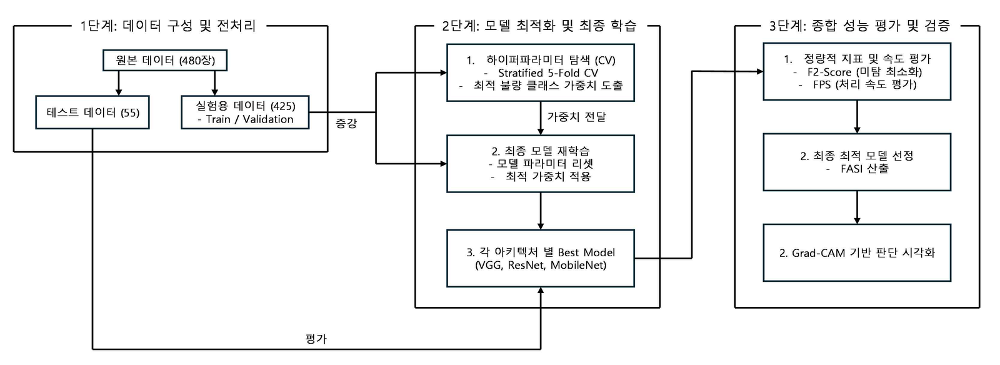
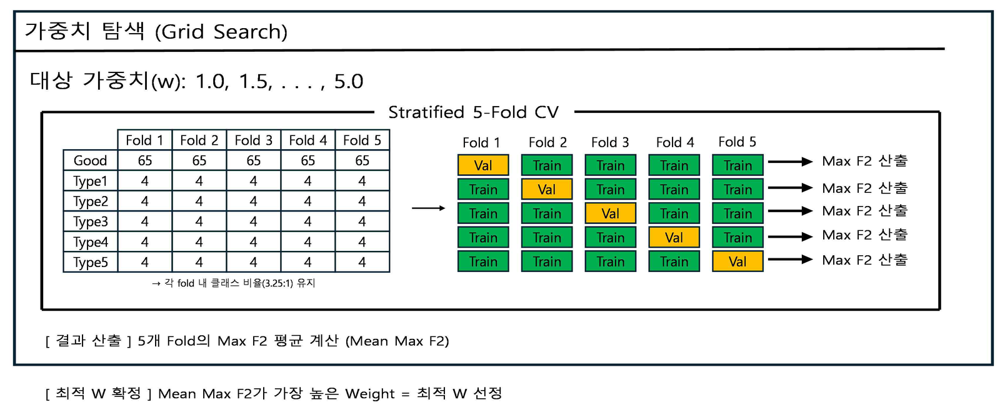
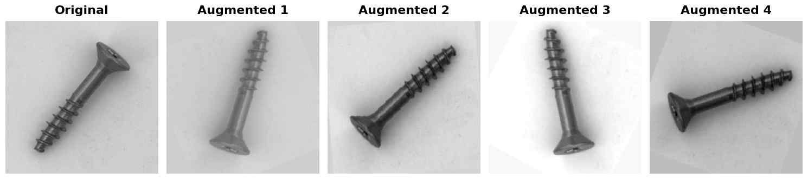
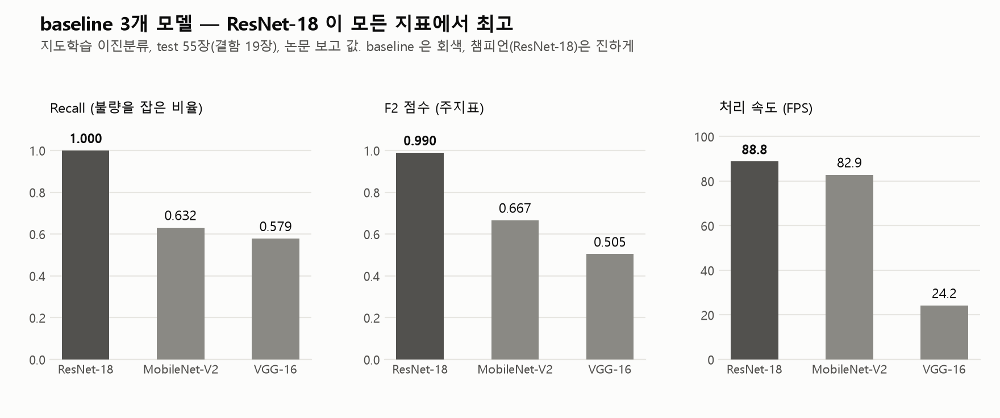
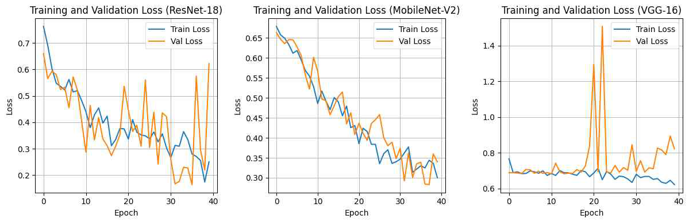
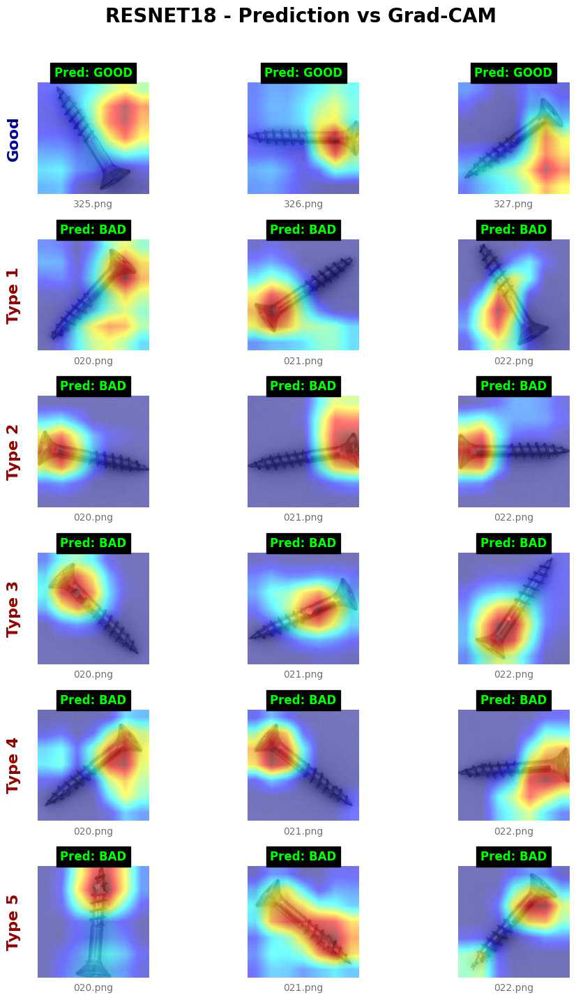
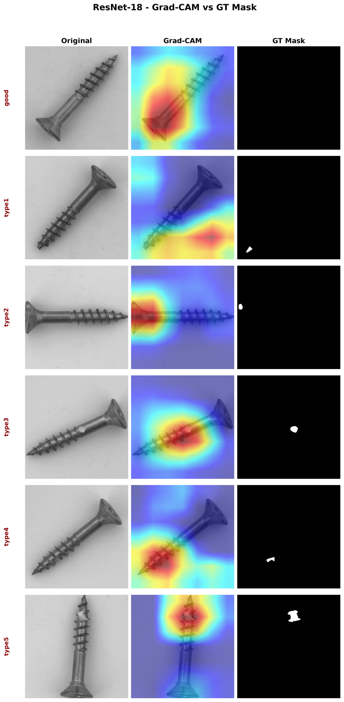

# Baseline — 지도학습 이진분류 (ResNet-18, MobileNet-V2, VGG-16)

"딥러닝 기반 나사 결함 탐지 모델 성능 비교에 관한 연구"(2026년 1학기 졸업논문, [PDF](thesis/딥러닝%20기반의%20나사%20결함%20탐지%20모델%20성능%20비교에%20관한%20연구.pdf)).
이 레포 이상탐지 트랙([patchcore.md](patchcore.md))의 **출발점이자 비교 기준선**이다. 코드는 `src/supervised/`, 실행은 `experiments/supervised/`.



- 졸업논문의 3단계 실험 파이프라인: 데이터 구성 → 가중치 탐색과 최종 학습 → 성능 평가와 Grad-CAM 검증
- 입력/출력: 나사 이미지 → Good(0) / Bad(1). 불량 미검출(FN) 최소화가 핵심이라 주지표는 **F2**
- 데이터: MVTec `screw` 480장 — `splits/baseline_split.csv` 고정 분할, train 425(정상 325 + 결함 100) / test 55(정상 36 + 결함 19). 결함 5유형은 모두 불량(1)으로 합침 → [overview.md §3](overview.md)
- 논문 실험 환경: Intel Core Ultra 9 285K / RTX 5080 / Python 3.10.20 / PyTorch 2.10.0(cu128)

## 1. 모델과 학습

| 모델 | 교체 레이어 | 파라미터 |
|---|---|---:|
| ResNet-18 | `fc = Linear(512, 2)` | 11.2M |
| MobileNet-V2 | `classifier[1] = Linear(1280, 2)` | 3.4M |
| VGG-16 | `classifier[6] = Linear(4096, 2)` | 138M |

ImageNet pretrained 3종, 헤드만 교체 후 전체 파인튜닝.



- 클래스 불균형(정상 3.25 : 결함 1) 처리: `CrossEntropyLoss(weight=[1.0, bad_weight])`, `bad_weight`를 1.0~5.0(0.5 간격)으로 Grid Search
- Stratified 5-Fold CV의 **Mean Max F2**로 챔피언 가중치를 정하고, 전체 학습 데이터로 재학습해 best val F2 체크포인트로 test 평가
- Optimizer: Adam(lr 1e-4), 재학습은 AdamW(lr 1e-4, weight decay 1e-2), F2 기준 early stopping(patience 10)
- 지표: `F2 = 5PR/(4P+R)`, `FASI = α·F2 + (1-α)·FPS_normalized` (α=0.7, 산업 배포용 성능·속도 복합)



- 학습 증강: 회전(±180°), 랜덤 크롭, 좌우·상하 반전, 밝기·대비 변화 (나사가 어느 방향으로 놓여도 인식하도록). 평가는 Resize(256) + CenterCrop(224)

## 2. 결과 (test 55장, 논문 보고 값) — `results/supervised/classification.csv`



| 모델 | 챔피언 가중치 | Mean Max F2 | Precision | Recall | F2 | FPS | FASI |
|---|---:|---:|---:|---:|---:|---:|---:|
| **ResNet-18** | 2.0 | 0.8485 | **0.9500** | **1.0000** | **0.9896** | **88.8** | **0.9927** |
| MobileNet-V2 | 2.5 | 0.8679 | 0.8571 | 0.6316 | 0.6667 | 82.9 | 0.7468 |
| VGG-16 | 5.0 | 0.6129 | 0.3333 | 0.5789 | 0.5046 | 24.2 | 0.4373 |

ResNet-18이 F2, Recall, FASI 모두 최고라 최종 모델로 선정했다.



학습 곡선 (왼쪽부터 ResNet-18, MobileNet-V2, VGG-16)
- ResNet-18: 학습 손실이 0.2 부근까지 내려가며 학습이 진행되지만 검증 손실은 변동이 큼
- MobileNet-V2: 두 손실이 완만하게 함께 감소
- VGG-16: 학습 손실이 0.6~0.7에서 거의 내려가지 않고 검증 손실이 크게 튀어 학습이 불안정, 낮은 성능과 일치

### MobileNet-V2 Repeated Holdout (5 seeds)

Val-Test 성능 역전 원인 분석을 위해 시드 5개로 반복(`mobilenet_repeated_holdout.ipynb`). 평균 Test F2 **0.8183 ± 0.044**.
역전은 5회 중 3회뿐이었고, Bad 19장짜리 소규모 test의 높은 분산 때문으로 해석했다.

| Seed | Best Weight | Val F2 | Test F2 | Val-Test 갭 |
|---|---:|---:|---:|---:|
| 42 | 2.0 | 0.8306 | 0.7653 | −0.065 |
| 123 | 4.0 | 0.8523 | 0.8854 | +0.033 |
| 456 | 3.5 | 0.8338 | 0.7843 | −0.050 |
| 789 | 3.0 | 0.8639 | 0.8065 | −0.057 |
| 101 | 2.5 | 0.8437 | 0.8500 | +0.006 |

### 재학습 변동

같은 설정(ResNet-18, weight 2.0)으로 다시 학습한 모델은 Test F2가 0.885~0.904로 논문 값(0.9896)보다 낮다
(저장 모델 `best_model.pth` 0.885, 새 구조 재학습 0.904). test가 55장(결함 19장)이라 결과가 흔들린다.

## 3. Grad-CAM 시각화와 위치평가

분류기에는 픽셀 이상맵이 없어 **Grad-CAM 히트맵을 이상맵 대신** 쓴다. test 결함 19장에 대해 GT 마스크와 비교한다.

<table>
<tr>
<td width="50%" align="center"><br>논문 그림: ResNet-18 예측과 Grad-CAM (유형별 3장, 표시된 18장 모두 정답 판정)</td>
<td width="50%" align="center"><br>Grad-CAM과 GT 마스크 비교 (유형별 1장): 분류는 맞아도 Type1은 결함에서 벗어나고 Type4는 결함 주변을 넓게 칠함</td>
</tr>
</table>

`experiments/supervised/localization_eval.py`, 결과 `results/supervised/localization.csv` (ResNet-18, weight 2.0):

| 구분 | n | Pixel AUROC | AUPRO |
|---|---:|---:|---:|
| 전체 | 19 | 0.921 | 0.814 |
| Type1 (나사끝) | 4 | 0.928 | 0.743 |
| Type2 (나사머리) | 4 | 0.965 | 0.882 |
| Type3 (나사목) | 5 | 0.980 | 0.922 |
| **Type4 (나사산 측면)** | 3 | **0.650** | **0.449** |
| Type5 (나사산 상단) | 3 | 0.987 | 0.952 |

같은 test에서 이미지 단위는 Precision 0.85 / Recall 0.895 / F2 0.885 / Image AUROC 0.978. → **분류는 잘하지만 Type4 위치는 거의 못 짚는다.**
표본이 19장(Type4는 3장)이라 분산이 크다. 이 한계가 [이상탐지 고도화](patchcore.md)의 동기다.

위치평가 구현 시 함정(해결됨):

| # | 함정 | 해결 |
|---|---|---|
| 1 | Grad-CAM이 `torch.no_grad()` 안에서 동작 안 함(역전파로 히트맵 계산) | no_grad **밖에서** 호출 |
| 2 | CAM↔마스크 크기 불일치로 pixel AUROC 이상 | 마스크를 `val_transform`과 동일하게 Resize(256)+CenterCrop(224), **NEAREST** 보간 |
| 3 | 공개 `AUPRO`가 원시 텐서를 못 받음(Batch 필드 요구) | `anomalib.metrics.aupro._AUPRO` 직접 사용 |
| 4 | good 이미지를 AUPRO에 포함하면 왜곡 | pixel AUROC/AUPRO는 **결함 이미지만** 대상 |

## 4. 코드 구성 (`src/supervised/`)

| 파일 | 역할 |
|---|---|
| `data.py` | 매니페스트 접근: `list_records(split, classes)`, `list_class`, `class_of(path)`, `image_path`. 이미지는 `data/screw`, 정렬은 filename 순(과거 `sorted(os.listdir)`와 동일) |
| `dataset.py` | `ScrewDataset`, `train/val_transform`, `get_image_paths_and_labels(split, CLASS_NAMES)`, 반복 홀드아웃 분할(`full_train_test_split`), `custom_Stratified_K_Fold` |
| `model.py` | `build_model_bin(name)` — resnet18 / mobilenet_v2 / vgg16 |
| `engine.py` | Grid Search + 5-Fold CV, `train_with_best_weight`(재학습 + test 평가) |
| `visualization.py` | Grad-CAM 그리드(랜덤/고정 파일), Confusion Matrix, weight-vs-F2 플롯. target layer: resnet→`layer4[-1]`, mobilenet/vgg→`features[-1]` |
| `loc_eval.py` | Grad-CAM 위치평가(Pixel AUROC·AUPRO, 유형별), 위치 그리드 |

## 5. 재현

```bash
python experiments/supervised/localization_eval.py     # 위치평가 재현: 위 표와 소수점 4자리까지 일치
python experiments/figures/extract_baseline_figures.py # 이 문서의 논문 그림 추출
```
`localization_eval.py`의 `__main__`은 저장된 `outputs/supervised/best_model.pth`로 test만 수행한다. 모델을 다시 만들려면
`train_final_model(train_records, best_weight)` 주석을 풀어 학습한다. 노트북은 `experiments/supervised/`에서 실행(레포 루트를 `sys.path`에 추가하도록 되어 있다).
