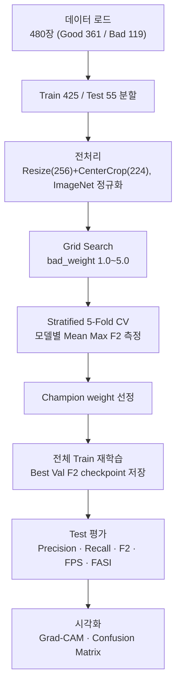

# Baseline — 지도학습 이진분류 (졸업논문)

"딥러닝 기반 나사 결함 탐지 모델 성능 비교에 관한 연구"(2026년 1학기 코스모스 졸업논문, [PDF](thesis/딥러닝%20기반의%20나사%20결함%20탐지%20모델%20성능%20비교에%20관한%20연구.pdf)).
이 레포 이상탐지 트랙의 **출발점이자 비교 기준선**이다. 코드는 `src/supervised/`, 실행은 `experiments/supervised/`.

- **입력/출력**: 나사 이미지 → Good(0) / Bad(1). 불량 미검출(FN) 최소화가 핵심이라 주지표는 **F2**.
- **데이터**: MVTec `screw` 480장(good 361 / bad 119) — `splits/baseline_split.csv` 고정 분할(train 425 / test 55). → [overview.md §3](overview.md)
- **클래스 불균형 처리**: `CrossEntropyLoss(weight=[1.0, bad_weight])`, `bad_weight` 는 1.0~5.0 Grid Search.

## 파이프라인



- 모델: ImageNet pretrained ResNet-18(`fc=Linear(512,2)`, 11.2M) / MobileNet-V2(`classifier[1]=Linear(1280,2)`, 3.4M) / VGG-16(`classifier[6]=Linear(4096,2)`, 138M). 헤드만 교체 후 전체 파인튜닝.
- 학습: Adam lr=1e-4(재학습은 AdamW lr=1e-4, wd=1e-2), F2 기준 early stopping(patience 10), best val F2 checkpoint 복원 후 test 평가.
- 지표: `F2 = 5PR/(4P+R)`, `FASI = α·F2 + (1-α)·FPS_normalized` (α=0.7, 산업 배포용 성능·속도 복합).
- 논문 실험 환경: Intel Core Ultra 9 285K / RTX 5080 / Python 3.10.20 / PyTorch 2.10.0(cu128).

## 결과 (Test 55장) — `results/supervised/classification.csv`

| 모델 | Precision | Recall | F2 | FPS | FASI |
|------|-----------|--------|-----|-----|------|
| **ResNet-18** | **0.9500** | **1.0000** | **0.9896** | **88.8** | **0.9927** |
| MobileNet-V2 | 0.8571 | 0.6316 | 0.6667 | 82.9 | 0.7468 |
| VGG-16 | 0.3333 | 0.5789 | 0.5046 | 24.2 | 0.4373 |

Grid Search 챔피언 weight(Mean Max F2): ResNet-18 2.0 (0.8485) · MobileNet-V2 2.5 (0.8679) · VGG-16 5.0 (0.6129). ResNet-18 이 최종 모델.

### MobileNet-V2 Repeated Holdout (5 seeds)

Val-Test 성능 역전 원인 분석을 위해 시드 5개로 반복(`mobilenet_repeated_holdout.ipynb`). 평균 Test F2 **0.8183 ± 0.044**.
역전은 5회 중 3회뿐이었고, Bad 19장짜리 소규모 test 의 높은 분산 때문으로 해석했다.

| Seed | Best Weight | Val F2 | Test F2 | Val-Test 갭 |
|------|-------------|--------|---------|-------------|
| 42 | 2.0 | 0.8306 | 0.7653 | −0.065 |
| 123 | 4.0 | 0.8523 | 0.8854 | +0.033 |
| 456 | 3.5 | 0.8338 | 0.7843 | −0.050 |
| 789 | 3.0 | 0.8639 | 0.8065 | −0.057 |
| 101 | 2.5 | 0.8437 | 0.8500 | +0.006 |

## Grad-CAM 위치평가 — `experiments/supervised/localization_eval.py`, 결과 `results/supervised/localization.csv`

분류기에는 픽셀 이상맵이 없어 **Grad-CAM 히트맵을 이상맵 대신** 쓴다. test 결함 19장에 대해 GT 마스크와 비교한다(ResNet-18, weight 2.0).

| 구분 | n | Pixel AUROC | AUPRO |
|------|---|-------------|-------|
| 전체 | 19 | 0.921 | 0.814 |
| Type1 | 4 | 0.928 | 0.743 |
| Type2 | 4 | 0.965 | 0.882 |
| Type3 | 5 | 0.980 | 0.922 |
| **Type4 (나사산 측면)** | 3 | **0.650** | **0.449** |
| Type5 | 3 | 0.987 | 0.952 |

같은 test 에서 이미지 단위는 Precision 0.85 / Recall 0.895 / F2 0.885 / Image AUROC 0.978. → **분류는 잘하지만 Type4 위치는 거의 못 짚는다.**
표본이 19장(Type4 는 3장)이라 분산이 크다. 이 한계가 [이상탐지 고도화](anomaly.md)의 동기다.

위치평가 구현 시 함정(해결됨):

| # | 함정 | 해결 |
|---|------|------|
| 1 | Grad-CAM 이 `torch.no_grad()` 안에서 동작 안 함(역전파로 히트맵 계산) | no_grad **밖에서** 호출 |
| 2 | CAM↔마스크 크기 불일치로 pixel AUROC 이상 | 마스크를 `val_transform` 과 동일하게 Resize(256)+CenterCrop(224), **NEAREST** 보간 |
| 3 | 공개 `AUPRO` 가 원시 텐서를 못 받음(Batch 필드 요구) | `anomalib.metrics.aupro._AUPRO` 직접 사용 |
| 4 | good 이미지를 AUPRO 에 포함하면 왜곡 | pixel AUROC/AUPRO 는 **결함 이미지만** 대상 |

## 코드 구성 (`src/supervised/`)

| 파일 | 역할 |
|------|------|
| `data.py` | 매니페스트 접근: `list_records(split, classes)`, `list_class`, `class_of(path)`, `image_path`. 이미지는 `data/screw`, 정렬은 filename 순(과거 `sorted(os.listdir)` 와 동일) |
| `dataset.py` | `ScrewDataset`, `train/val_transform`, `get_image_paths_and_labels(split, CLASS_NAMES)`, 반복 홀드아웃 분할(`full_train_test_split`), `custom_Stratified_K_Fold` |
| `model.py` | `build_model_bin(name)` — resnet18 / mobilenet_v2 / vgg16 |
| `engine.py` | Grid Search + 5-Fold CV, `train_with_best_weight`(재학습 + test 평가) |
| `visualization.py` | Grad-CAM 그리드(랜덤/고정 파일), Confusion Matrix, weight-vs-F2 플롯. target layer: resnet→`layer4[-1]`, mobilenet/vgg→`features[-1]` |
| `loc_eval.py` | Grad-CAM 위치평가(Pixel AUROC·AUPRO, 유형별), 위치 그리드 |

## 재현

```bash
python experiments/supervised/localization_eval.py     # 위치평가 재현: 위 표와 소수점 4자리까지 일치
```
`localization_eval.py` 의 `__main__` 은 저장된 `outputs/supervised/best_model.pth` 로 test 만 수행한다. 모델을 다시 만들려면
`train_final_model(train_records, best_weight)` 주석을 풀어 학습한다. 노트북은 `experiments/supervised/` 에서 실행(레포 루트를 `sys.path` 에 추가하도록 되어 있다).
