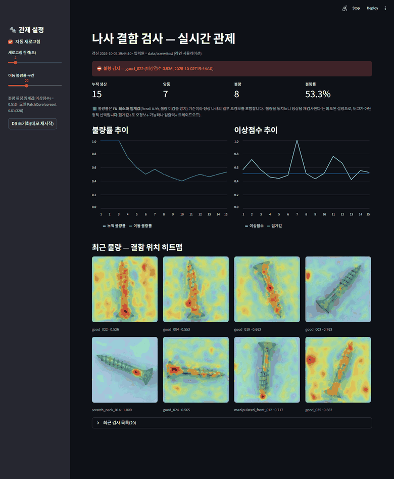
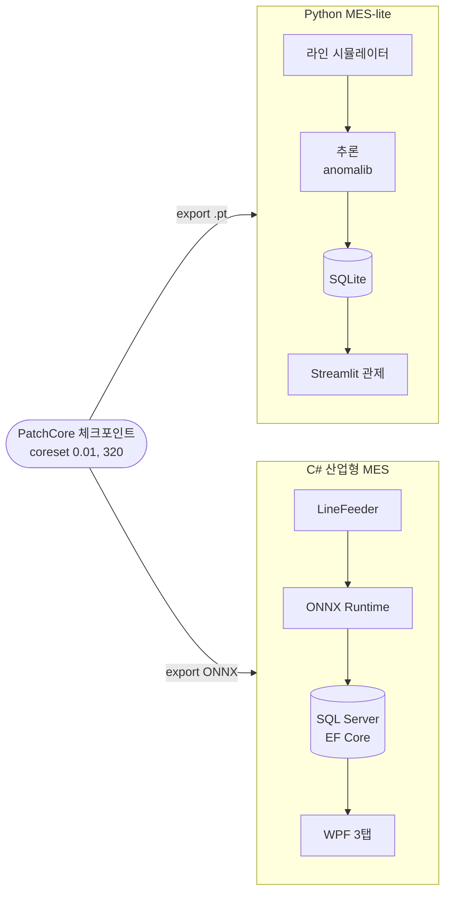
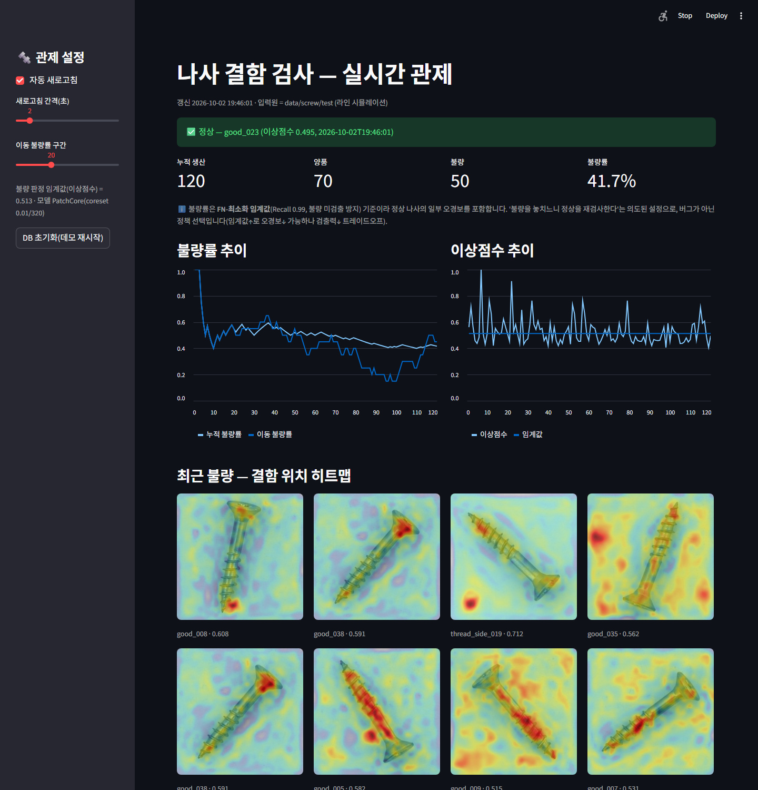
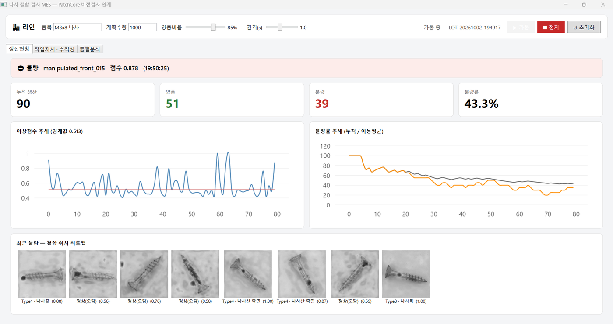
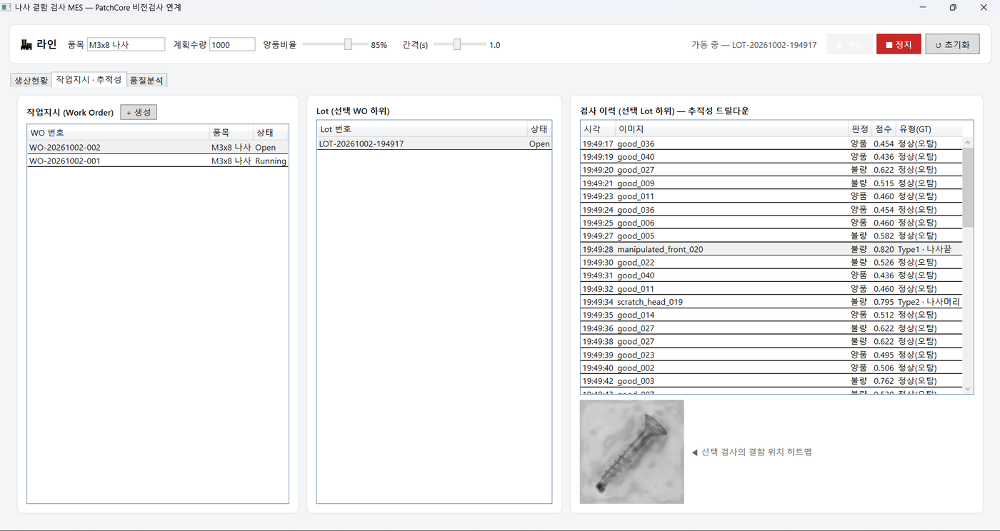
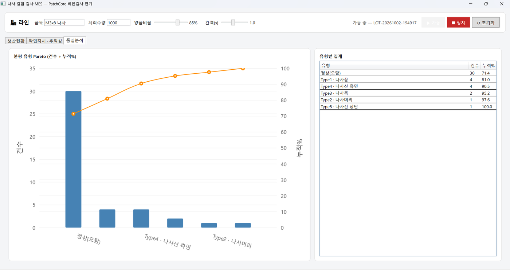

<div align="center">

# MES 운용
### 학습한 PatchCore 모델을 생산 현장 형태로 운용 — Python MES-lite · C# 산업형 MES



라인 시뮬레이터가 흘려보낸 나사를 실시간 판정 — 불량률·이상점수 추이와 결함 위치 히트맵 (Python MES 대시보드)

</div>

실험으로 선택한 모델(PatchCore, coreset 0.01, 해상도 320)을 검사 시스템에 연결한 부분만 따로 정리한 문서. 모델 선택 과정과 성능은 [루트 README](../README.md), 실험 상세는 [patchcore.md](patchcore.md).

## 요약

- 같은 모델을 두 가지 형태로 운용
  - Python MES-lite: 라인 시뮬레이터 → 추론 → SQLite → Streamlit 관제 (연구·데모용)
  - C# 산업형 MES: ONNX Runtime 추론 → SQL Server → WPF, 작업지시와 Lot 추적성 포함 (현업 스택)
- 같은 체크포인트를 Torch(.pt)와 ONNX로 export해 두 MES가 동일한 판정을 내는지 검증 (C#과 Python 점수 일치 36/36)
- 모든 검사 이미지는 MVTec test 시뮬레이션이며 실제 카메라 입력은 연결하지 않음

| 항목 | 내용 |
|---|---|
| 모델 | PatchCore (WideResNet-50, coreset 0.01, 해상도 320), 판정 임계값 0.513 |
| 입력 | 라인 시뮬레이터가 MVTec screw test 이미지를 1장씩 투입 (양품 비율 조정 가능) |
| 출력 | 양품/불량 판정, 이상 점수, 결함 위치 히트맵 |
| 검출 | 결함 119장 중 118장 검출 (Recall 0.992), 정상 41장 중 15장 오경보 (재학습 모델 기준) |
| 처리 속도 | 28 FPS (p50 35ms, 측정 당시 RTX 2070 SUPER) |
| 기록 | Python: SQLite 1개 파일 / C#: SQL Server(LocalDB), WO → Lot → 검사 3계층 |

## 1. 구성



- 모델 배포
  - anomalib의 export가 전처리(Resize, Normalize)와 점수 정규화를 그래프에 내장해, 두 경로 모두 입력은 원본 RGB를 255로 나눈 값
  - 판정은 모델 내장 라벨이 아니라 임계값 0.513을 직접 적용 (Python과 C#이 같은 값을 사용하므로 바꾸면 양쪽을 함께 갱신)
- C# 레이어
  - Core(도메인, 인터페이스) → Inference(ONNX) → Data(EF Core) → Simulator → App(WPF MVVM)
  - 추론 구현을 인터페이스로 분리해 ONNX를 REST 등으로 바꿔도 상위 레이어는 그대로
- 추적성: 작업지시(WO) 1:N Lot 1:N 검사
- 상세: [../mes/README.md](../mes/README.md), [../csharp/README.md](../csharp/README.md)

## 2. Python MES-lite



- 라인 시뮬레이터가 test 이미지를 1장씩 흘려보내 추론하고 SQLite에 기록, Streamlit이 실시간 표시
- 구성: 누적 생산, 양품, 불량, 불량률 KPI / 불량률, 이상점수 추이 / 불량 판정 히트맵 갤러리 / 실시간 알람
- 갤러리의 `good_*` 항목은 정상을 불량으로 판정한 오경보 (불량률 40%대는 임계값 0.513과 오경보의 결과이며, 화면에 안내 문구를 표시)
- test 셋은 결함이 75%(평가용)라 시뮬레이터에서 양품 비율만 현실화해 복원추출 (데이터를 바꾸는 것이 아니라 유입 빈도 조정)
- 결함 유형(Type1~5) 자동분류는 제외 — 히트맵 최고점이 유형과 무관하게 중앙으로 쏠려 위치 기반 분류가 무작위 수준(20%)이었음

## 3. C# 산업형 MES

<table>
<tr>
<td width="50%"><br>생산현황: 실시간 KPI, 이상점수·불량률 추세, 불량 히트맵</td>
<td width="50%"><br>작업지시 · 추적성: WO → Lot → 검사 이력, 선택 검사의 결함 위치 히트맵</td>
</tr>
<tr>
<td><br>품질분석: 불량 유형 Pareto (정상 오탐이 가장 큼)</td>
<td>

- WPF(MVVM) + EF Core 코드퍼스트 + SQL Server(LocalDB)
- 작업지시(WO) 생성, 가동 시 Lot 자동 시작, 검사마다 판정 기록
- 외부 Python 없이 ONNX Runtime으로 .NET에서 직접 추론
- 결함 유형(Pareto)은 모델 산출이 아니라 시뮬레이터가 소스 폴더명(정답)으로 주입한 값, 정상을 불량으로 판정하면 "정상(오탐)"으로 집계

</td>
</tr>
</table>

## 4. ONNX 파리티 검증

- C#과 Python이 같은 점수를 내는지 test 36장으로 검증 (`ScrewMes.ParityCheck`)
- 재학습 모델 기준 최대 |Δ| 0.0016, 판정 일치 36/36 (최초 학습 모델 0.0001)
- Python 쪽 ONNX 대 Torch 점수 비교도 36/36 (최대 |Δ| 0.0016)

## 5. 실행 방법 (레포 루트에서)

```bash
# 모델 준비 (체크포인트가 없으면 약 9~20분)
python experiments/anomaly/run_resolution_sweep.py 0.01 320
python -m mes.core.export_model                    # ckpt → 배포용 .pt

# Python MES (두 터미널)
python -m mes.simulator.line_feeder inf 1.0 0.9    # A: 라인 가동 (장수|inf, 간격(초), 양품 비율)
streamlit run mes/dashboard/app.py                 # B: http://localhost:8501

# C# MES (.NET 8 SDK + SQL Server LocalDB 필요)
python -m mes.core.export_onnx                     # ckpt → csharp/model/model.onnx
dotnet run --project csharp/ScrewMes.ParityCheck -c Release
dotnet run --project csharp/ScrewMes.App -c Release
```

## 6. 한계

- 정상 오경보가 큼: 재학습 모델은 정상 41장 중 15장을 불량으로 판정 (최초 학습 모델은 9장), 학습마다 편차가 있어 대시보드 불량률이 40%대로 보임. 불량을 놓치지 않는 방침(임계값 0.513, FN 최소화)의 대가이며, 현장에서는 재검 부담이 되므로 임계값 재선정(val 홀드아웃)이 필요
- 시연은 MVTec test 이미지 시뮬레이션이며 실제 카메라 입력, 현장 데이터는 검증하지 않음
- C#의 결함 유형(Pareto)은 모델이 아니라 정답 폴더명을 주입한 값 (현업에서는 작업자 재검 시 입력하는 자리)
- `mes/api/server.py`(FastAPI 추론 서비스 분리)는 미구현 스텁
