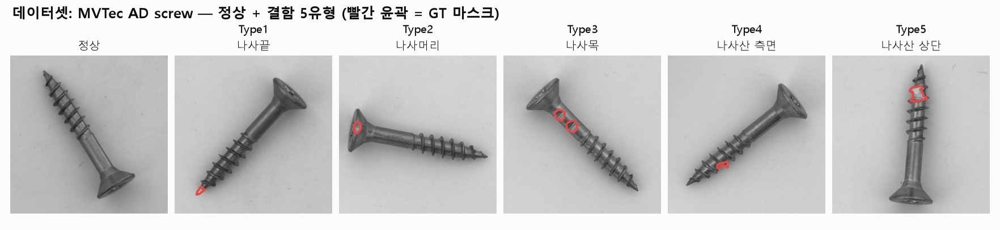
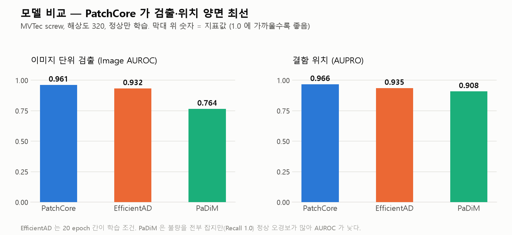
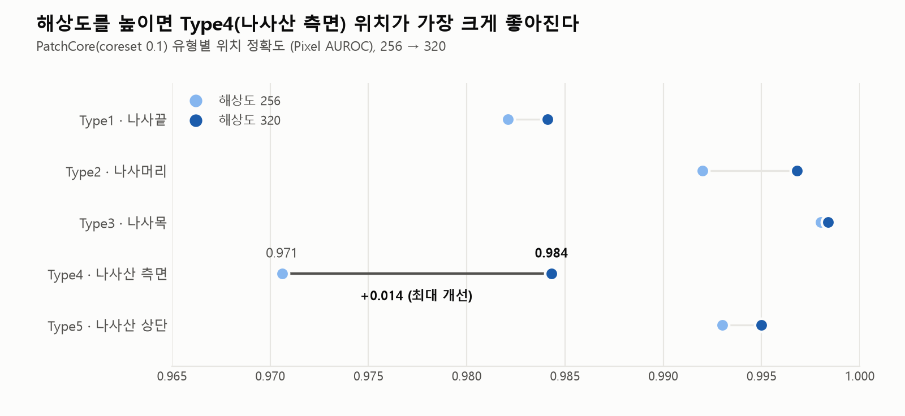
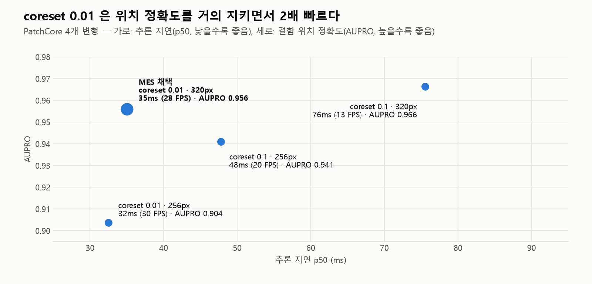
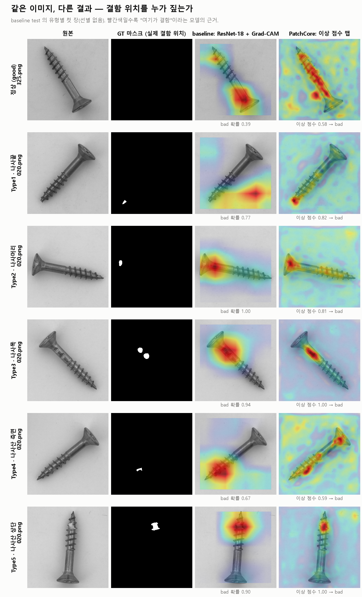
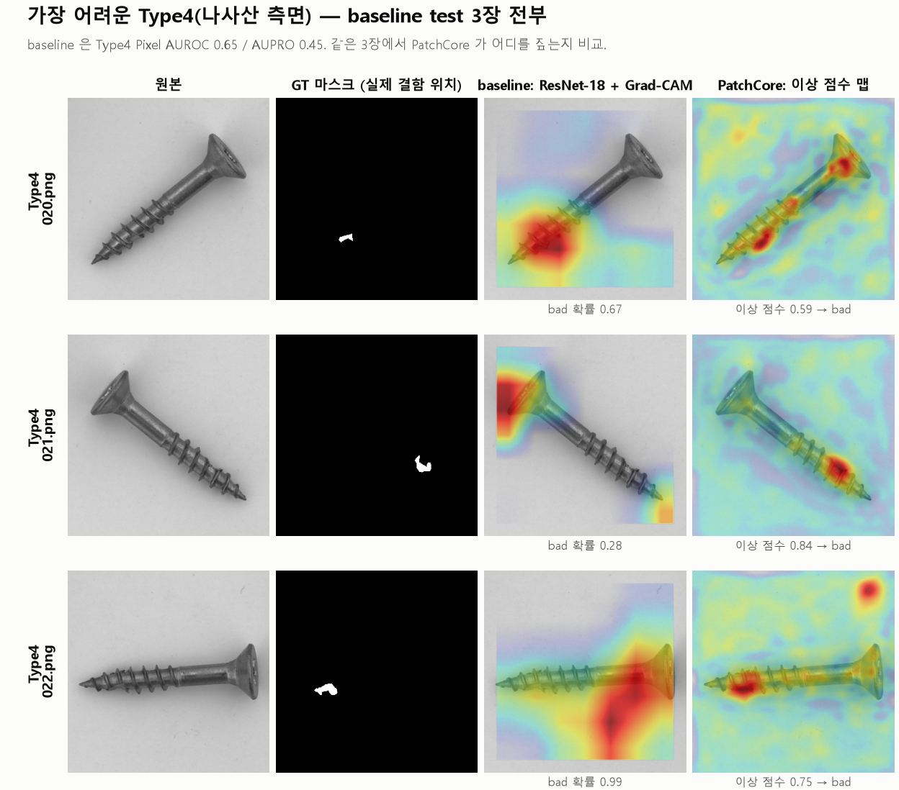
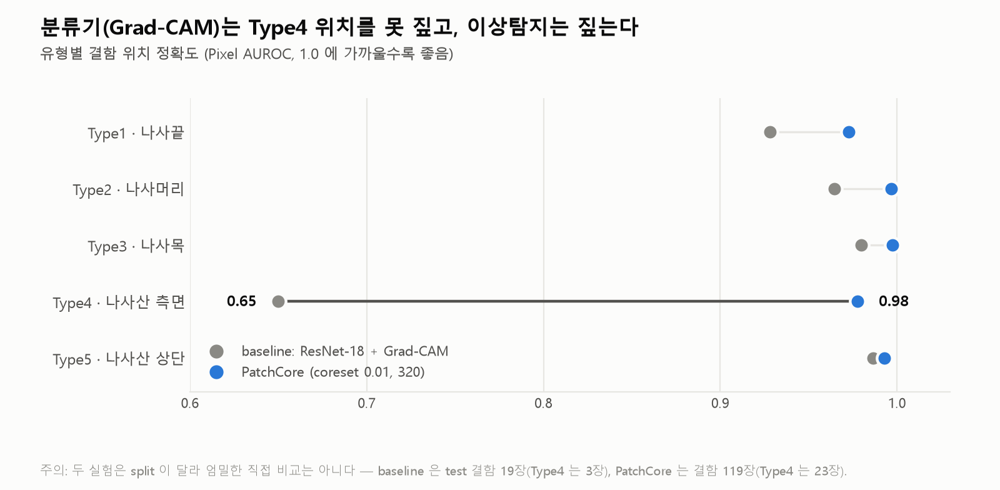

# 이상탐지 — PatchCore (+ EfficientAD, PaDiM 비교)

정상(good) 이미지만 학습하는 비지도 이상탐지로 나사 결함을 검출·국소화한다. 코드는 `src/anomaly/`(+ anomalib 2.5), 실행은 `experiments/anomaly/`,
커밋하는 결과는 `results/anomaly/`. 출발점인 지도학습은 [baseline.md](baseline.md), 모델을 운용하는 부분은 [mes.md](mes.md).


> 정상(good)은 차분하고 결함은 그 위치만 뜨겁게 반응한다(괄호=이상점수, 임계값 0.513). good/결함을 공통 색 스케일로 칠하고 배경을 억제했으며,
> 각 유형의 표본은 GT 마스크와의 농도비로 자동 선별했다. 생성: `python experiments/anomaly/build_heatmap_grid.py`.

## 1. 설계

- **분할**: anomalib 표준 MVTec 프로토콜 — train = 정상 320, test = 정상 41 + 결함 119(GT 마스크 포함). 결함 119장 **전부가 평가 데이터**
- **모델**: 주력 PatchCore(WideResNet-50, layer2+3, coreset 메모리뱅크, k=9) / 비교 EfficientAD(small, 학습형) · PaDiM(resnet18)
- **성능 향상 축**: 입력 해상도(256/320 — Type1·Type4 같은 미세 결함 가설), PatchCore coreset 비율(0.1 / 0.01)
- **임계값**: test에서 F2 최대화 → **0.513**. FN 최소화 기조(F2 = Recall 4배 가중) — [decisions.md §7](decisions.md)
- **지표**: 이미지(AUROC·F2·Recall·Precision) / 픽셀(Pixel AUROC·AUPRO) / 유형별. `src/anomaly/ad_eval.py`

| 구분 | 이상탐지 (MVTec 표준) | baseline (논문 분할) |
|---|---|---|
| 학습 | 정상 320장 | 정상 325 + 결함 100 = 425장 |
| 평가 | 정상 41 + 결함 119 = 160장 | 정상 36 + 결함 19 = 55장 |



데이터: [MVTec AD](https://www.mvtec.com/company/research/datasets/mvtec-ad) screw (1024×1024, CC BY-NC-SA 4.0). 결함 5유형(이미지 수):
Type1 manipulated_front(24) · Type2 scratch_head(24) · Type3 scratch_neck(25) · Type4 thread_side(23) · Type5 thread_top(23).

## 2. 모델 비교 — PatchCore · EfficientAD · PaDiM · [상세](../results/anomaly/model_compare/RESULTS.md)



| 모델 | 방식 | Image AUROC | AUPRO(320) | Type4 위치(320) | 비고 |
|---|---|---:|---:|---:|---|
| **PatchCore** | 정상 패치 특징의 메모리뱅크 + 최근접 거리 | **0.96** | **0.966** | **0.984** | 주력 |
| EfficientAD | student-teacher + autoencoder | 0.85~0.93 | 0.935 | 0.955 | 학습형(20 epoch 간이), 해상도↑에 민감 |
| PaDiM | 패치별 가우시안 분포 | 0.76 | 0.908 | 0.945 | Recall 1.0이나 정상 오경보 ~40/41 |

- **PatchCore가 검출·위치 양면 최선** — 주력 모델의 정량 근거
- EfficientAD는 20 epoch 간이 학습이라 "동일·간이 조건 비교"로 해석할 것
- EfficientAD 함정: 전처리에 Normalize를 넣으면 에러 → `make_pp(res, normalize=False)`, batch=1 강제, imagenette 1.5GB 자동 다운로드

## 3. 해상도 스윕 (PatchCore, coreset 0.1) · [상세](../results/anomaly/sweep_cs01/RESULTS.md)



| 설정 | Image AUROC | F2 | Recall | AUPRO | Type4 위치 | 시간 |
|---|---:|---:|---:|---:|---:|---:|
| 256 | 0.9627 | 0.9738 | 1.000 (FN 0) | 0.9409 | 0.9706 | 146 s |
| **320** | 0.9611 | 0.9701 | 0.9832 (FN 2) | **0.9663** | **0.9843** | 4212 s (70분) |

- **해상도↑로 Type4(나사산 측면) 위치가 가장 크게 개선**(0.971 → 0.984): 미세·국소 결함에는 고해상도가 유효함을 정량 입증
- 단 320에서 이미지 단위는 FN 2(Type3·Type4 각 1)로 흔들렸다 — 위치(where)는 개선됐으나 판정(whether)은 임계값 영향을 받는다
- 512는 추론 거리계산 텐서가 ~7.5GB를 한 번에 요구해 8GB GPU에서 coreset과 무관하게 OOM → 미진행

## 4. coreset 0.1 vs 0.01 (320) · [상세](../results/anomaly/sweep_cs001/RESULTS.md)



| 지표 (320) | coreset 0.1 | coreset 0.01 | 변화 |
|---|---:|---:|---|
| 학습 시간 | 4212 s (70분) | **538 s (9분)** | 7.8배↓ |
| 추론 지연 p50 | 76ms (13 FPS) | **35ms (28 FPS)** | 2배↓ |
| Image AUROC | 0.9611 | 0.9639 | 소폭↑ |
| Recall / FN | 0.9832 / 2 | 0.9916 / 1 | 동급+ |
| AUPRO | **0.9663** | 0.9560 | −0.010 |
| Pixel AUROC | 0.9929 | 0.9904 | −0.0025 |
| Type4 위치 | **0.984** | 0.978 | −0.007 |

- 0.01은 고해상도를 실용화(70분→9분)하고 손실이 미미하다. 단 **최고 AUPRO는 여전히 0.1**. 운용 가이드: 정밀 우선 0.1@320 / 처리량 우선 0.01@320
- PatchCore 추론은 메모리뱅크 k-NN 거리계산이라 메모리뱅크 크기(coreset)가 곧 지연이다
- 측정 원칙: warm-up 10장 폐기, `cuda.synchronize()`, 전처리~후처리 end-to-end, p50/p95 보고. 측정 당시 환경은 RTX 2070 SUPER 이며 이 PC에서 재측정하지 않았다
- 4개 변형(`results/anomaly/patchcore_all.csv`):

| 변형 | coreset | res | 메모리뱅크 | p50 (ms) | p95 (ms) | FPS | AUPRO |
|---|---:|---:|---:|---:|---:|---:|---:|
| cs01_256 | 0.1 | 256 | 32,768 | 47.8 | 51.6 | 20.4 | 0.9409 |
| cs01_320 | 0.1 | 320 | 51,200 | 75.6 | 79.0 | 13.1 | 0.9663 |
| cs001_256 | 0.01 | 256 | 3,276 | 32.5 | 34.6 | 30.4 | 0.9036 |
| **cs001_320** | 0.01 | 320 | 5,120 | **35.0** | 40.4 | **28.0** | 0.9560 |

## 5. 결과 — baseline과 같은 이미지로 비교



- 표본은 baseline test의 유형별 첫 장 (선별하지 않음), 같은 이미지에 두 모델의 근거를 같은 방식으로 칠함
  - baseline은 Type1에서 결함이 없는 곳을 칠하고, Type3, Type4에서는 결함 주변의 넓은 영역만 가리킴
  - PatchCore는 Type1 나사끝을 정확히 짚고, Type2, Type5는 두 모델 모두 결함을 찾음
  - 정상 샘플(325번)은 이상 점수 0.58로 PatchCore가 불량으로 오판 (오경보)



- 가장 어려운 Type4 test 3장 전부
  - PatchCore는 3장 모두 실제 결함 위치에 반응하지만 022번은 배경에도 반응하고, 020번은 여러 곳으로 분산
  - baseline은 021, 022번에서 결함이 아닌 나사머리 쪽을 칠하고, 021번은 정상(bad 확률 0.28)으로 놓침



※ baseline(위치평가 결함 19장, Type4 3장)과 PatchCore(결함 119장, Type4 23장)는 split이 달라 엄밀한 직접 비교가 아니다.

| 항목 | 결과 |
|---|---|
| 판정 임계값 | 0.513 (test에서 F2 최대화, 불량을 놓치는 것을 정상 재검사보다 중시) |
| 재학습 모델 (coreset 0.01, 320) | 결함 119장 중 118장 검출 (Recall 0.992), 정상 41장 중 15장 오경보 (Precision 0.887) |
| 최초 학습 모델 | Recall 0.992, 정상 오경보 9장 (Precision 0.929) |
| Pixel AUROC, AUPRO | 재학습 0.990, 0.954 / 최초 0.990, 0.956 |

- 정상 오경보 수는 학습할 때마다 달라짐 (9~15장), 놓침은 1장으로 같음 — coreset 무작위 샘플링과 학습 환경(GPU, 라이브러리 버전) 차이가 섞여 있어 원인을 하나로 특정하지는 못함
- 임계값은 test로 튜닝한 값이라 Recall 0.992는 낙관적일 수 있음 (val 홀드아웃 필요)
- 결함 유형(Type1~5) 자동분류는 제외 — [decisions.md §8](decisions.md)

## 6. 코드 구성 (`src/anomaly/`)

| 파일 | 역할 |
|---|---|
| `ad_data.py` | `MVTecADFixed` — anomalib `Split` enum 버그(Py3.11에서 데이터 0건) 우회: split을 문자열로 전달. `build_screw_datamodule()` (anomalib이 비ASCII 경로를 거부해 상대경로로 변환) |
| `models.py` | `build_model(name)`(patchcore / efficient_ad / padim) + `run_experiment` |
| `ad_eval.py` | `collect_predictions`, `evaluate_all` — 이미지/픽셀 지표, AUPRO(`_AUPRO`), F2 임계값 튜닝, 유형별 표 |

모든 스크립트는 산출물을 `outputs/`(gitignore)에 쓰고, 커밋할 결과만 `results/anomaly/`로 옮긴다. 전체 히트맵·체크포인트는 용량 문제로 미포함.

```bash
python experiments/anomaly/run_resolution_sweep.py 0.01 [320]  # 해상도 스윕 (인자: coreset, 해상도 목록)
python experiments/anomaly/run_model_comparison.py all 20      # PaDiM / EfficientAD
python experiments/anomaly/bench_latency.py [all]              # 추론 latency·FPS
python experiments/figures/build_comparison.py                 # baseline vs PatchCore 비교 그림
```
